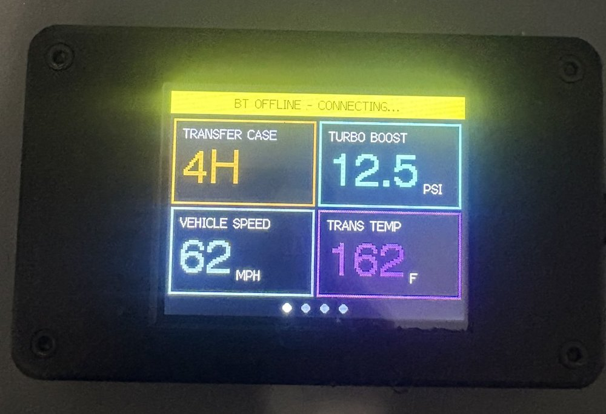
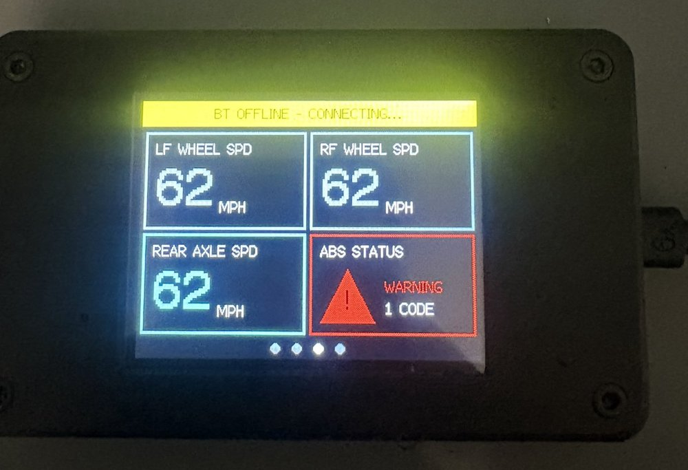
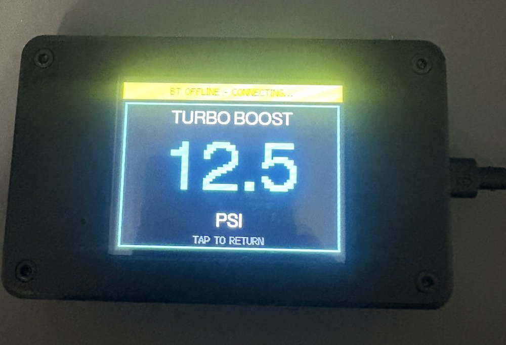
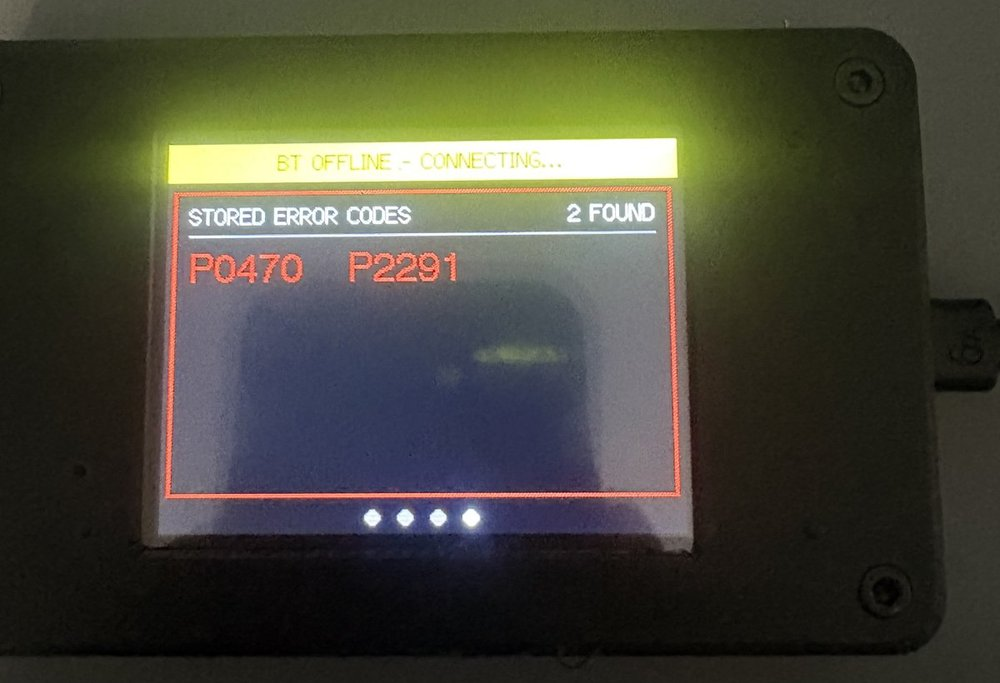

# CYD-OBDII — Diesel Diagnostics Dash

A touch-screen gauge display for a **2005 Ford Excursion 6.0L Powerstroke**, built on the
ESP32 "Cheap Yellow Display" (CYD). It talks to the truck through a Bluetooth ELM327 OBD-II
adapter and shows live engine, transmission and ABS data on swipeable pages of gauges,
plus a list of stored trouble codes.

Without an adapter it runs on demo values, so you can test the screens on the bench.

| Page 1: gauges | Page 3: ABS |
|---|---|
|  |  |
| **Full-screen gauge** | **Page 4: stored error codes** |
|  |  |

*The photos show demo mode (adapter not connected), so all the values are sample data.*

> **Help wanted:** some values still need the right Ford PIDs. See the
> [open issues](../../issues?q=is%3Aissue+is%3Aopen+label%3A%22help+wanted%22) if you know your way
> around 6.0L / Super Duty modules.

---

## Features

- **6 pages**, tap to move between them (page dots at the bottom show where you are)
  1. Transfer case · Turbo boost · Vehicle speed · Transmission temp
  2. FICM main power · Coolant temp · System volts · Engine RPM
  3. ABS: Left-front wheel speed · Right-front wheel speed · Rear axle speed · ABS status (warning triangle when the ABS module has stored codes)
  4. Engine trouble codes (up to 15, e.g. `P0470`): stored codes in red, then pending codes in
     yellow (detected once but not confirmed yet, so they show up before the check-engine light);
     green when clear. **Tap a code** to see what it means.
  5. **Drive log**: REC / MARK / STOP to record the gauges to the SD card, see [Drive log](#drive-log)
  6. **Settings**: brightness, units, alarm limits, power and WiFi, saved in flash, see
     [Settings page](#settings-page)
- **Tap menu**: tap any gauge to get **NEXT PAGE** and **FULL SCREEN** buttons.
  Full screen shows that one gauge as large as it fits; tap again to go back.
- **Gauge alarms**: a gauge that goes out of range (low FICM voltage, hot transmission or
  coolant, low or high system voltage) flashes red, and the status bar shows it on every page,
  see [Gauge alarms](#gauge-alarms).
- **Status bar** that never scrolls: connection state, demo mode, Bluetooth retry
  countdown, gauge alarms, a red warning when engine trouble codes are stored and a yellow one
  for pending codes.
- **Phone access over WiFi**: switch on the CYD's own hotspot to see the live gauges and codes on
  your phone and update the firmware without a cable, see
  [Phone access (WiFi)](#phone-access-wifi).
- **Auto brightness**: the CYD's light sensor dims the screen at night and brings it back to full
  brightness in daylight, see [Auto brightness](#auto-brightness).
- **Battery protection**: the screen turns off when the truck is off, then the display sleeps
  and checks every few minutes whether the truck is on, see [Battery protection](#battery-protection).
- **Demo mode**: runs on sample values whenever the adapter isn't connected, and keeps retrying
  the connection in the background so the screen and touch never freeze.
- **Fast polling**: only the values on screen are read from the truck, and every
  request waits for the adapter's `>` prompt, so readings never get mixed up.

## Hardware

| Part | Notes |
|---|---|
| ESP32-2432S028R ("Cheap Yellow Display") | 2.8" 320×240 ILI9341 screen, XPT2046 resistive touch |
| microSD card (optional) | For the drive log. FAT32; any size up to 32 GB is simplest |
| Bluetooth Classic ELM327 OBD-II adapter | Tested with an ELM327 v1.4b clone. Must be **Bluetooth Classic** (SPP), not BLE-only. |
| 3D-printed case | [Modular CYD case](https://www.thingiverse.com/thing:6991968) by DanielBrunod, remixed from [ncmreynolds' CYD enclosure](https://www.thingiverse.com/thing:6308391) (CC BY-SA). STL files in [`hardware/case/`](hardware/case/) |
| USB power in the truck | 5 V via the CYD's USB port |

No wiring is needed: the screen and touch are built into the CYD, and the adapter plugs
into the truck's OBD-II port under the dash.

## Vehicle / bus facts

These were confirmed on the truck with a PC and [`tools/obd_logger.py`](tools/) (see
[PC logging tool](#pc-logging-tool)):

- Protocol: **ISO 15765-4 CAN, 11-bit, 500 kbps** (ELM protocol 6, `ATSP6`), *not* J1850 PWM
- Engine PCM: requests to **7E0**, replies from **7E8**. A second module (7E9, likely the
  transmission) also answers standard requests.
- Standard PIDs confirmed working: `0104 0105 010B 010C 010D 010F 0110 011F 012F 0133 0142`
- Ford-specific FICM PID `2209D0` answers; the raw value is volts × 256
  (e.g. `0x2F80` → 47.5 V)

### From Ford's workshop manual (not yet confirmed on the truck)

A forum member checked the 2005 Excursion Workshop Manual, section 418-00 (Module
Communications Network):

- The **ABS module** and the **4WD control module** (Electronic Shift-on-the-Fly) talk over
  **ISO 9141, the K-line on OBD pin 7**, not HS-CAN or MS-CAN. That's why nothing answers at the
  CAN addresses tried so far, and why the CAN sniffer won't find wheel speeds or the transfer
  case. Reading them needs K-line access (see [Roadmap](#roadmap)). The PC logger's `--kline`
  probe finds which K-line addresses answer.
- **4WD module PIDs** (Ford names, numeric IDs not known yet): `4WD_SW` = selector position
  (`2WD` / `4WD` / `4WD LOW`, the *requested* position), `PLATE_A`–`PLATE_D` = shift-motor
  encoder contacts (the *actual* position), `VSS2` = vehicle speed input. Ford's Pinpoint Test C32:

  | Contact | 2H | 4H | 4L |
  |---|---|---|---|
  | PLATE_A | open | closed | closed |
  | PLATE_B | open | open | closed |
  | PLATE_C | closed | closed | open |
  | PLATE_D | open | open | open |

  Comparing `4WD_SW` with the plates also shows when a shift is still in progress.
- **ABS module PIDs** (from older Excursion documentation, may differ for 2005): `LF_WSPD`,
  `RF_WSPD`, `R_WSPD` (wheel speeds, 0–255 km/h; one rear-axle sensor), `CCNTABS` (number of
  stored ABS codes), `ABSLAMP`, `BRKLAMP`, `BOO_ABS` (brake pedal switch), `4WDABS`, inlet/outlet
  valve states and `PWR_RLY`. Ford ABS codes include `C1155` (LF wheel speed sensor), `C1145` (RF)
  and `C1230` (rear axle).

## Where each value comes from

| Gauge | Module / header | Request | Formula | Status |
|---|---|---|---|---|
| Turbo boost | PCM `7E0` | `010B` MAP, `0133` baro | (MAP − baro) kPa × 0.145 → psi, clamped at 0 | ✅ Confirmed |
| Vehicle speed | PCM `7E0` | `010D` | A km/h × 0.621 → mph | ✅ Confirmed |
| Engine RPM | PCM `7E0` | `010C` | (A×256 + B) / 4 | ✅ Confirmed |
| System volts | PCM `7E0` | `0142` | (A×256 + B) / 1000 | ✅ Confirmed |
| FICM main power | PCM `7E0` | `2209D0` | raw / 256 V | ✅ Confirmed |
| Coolant temp | PCM `7E0` | `221139` | raw / 256 °C → °F | ⚠️ Not yet confirmed |
| Trans temp | PCM `7E0` | `221E1C` | raw / 8 °F | ⚠️ Not yet confirmed |
| Engine trouble codes | PCM `7E0` | `03` | CAN Mode 03, multi-frame aware | ⚠️ Not yet confirmed |
| Pending trouble codes | PCM `7E0` | `07` | CAN Mode 07, same format as Mode 03 | ⚠️ Not yet confirmed |
| Transfer case | 4WD module, **K-line** | `4WD_SW`, `PLATE_A`–`D` | see the table above | ❌ Not on CAN: needs K-line access (code still tries `418F02`, which returns NO DATA) |
| Wheel speeds (LF/RF/rear) | ABS module, **K-line** | `LF_WSPD`, `RF_WSPD`, `R_WSPD` | 0–255 km/h | ❌ Not on CAN: needs K-line access (code still tries placeholders at `760`) |
| ABS trouble codes | ABS module, **K-line** | `CCNTABS` count | | ❌ Not on CAN: needs K-line access |

Turbo boost uses standard PID `0B`, which tops out at 255 kPa, so the gauge maxes out at about 22 psi of boost.

## Getting started

### 1. Tools
- [VS Code](https://code.visualstudio.com/) with the **PlatformIO** (or pioarduino) extension
- Libraries are installed automatically from `platformio.ini`:
  `TFT_eSPI 2.5.43`, `ELMDuino 3.4.1`. Touch has its own small driver
  ([`src/touch_bitbang.h`](src/touch_bitbang.h)), so the SD card can use the SPI bus

### 2. Set your adapter's Bluetooth address
In [`src/config.h`](src/config.h), replace the placeholder MAC with your adapter's address:

```cpp
const uint8_t ELM_MAC[6] = {0x01, 0x23, 0x45, 0x67, 0x89, 0xBA};
```

You can find the address by pairing the adapter with a phone or PC and checking its Bluetooth
details. The ESP32 connects with PIN `1234` (set in `src/main.cpp`).

### 3. Build and upload
Plug in the CYD over USB, then in PlatformIO: **Build**, then **Upload**. From a terminal:

```bash
pio run -t upload
pio device monitor        # 115200 baud
```

### 4. In the truck
Plug in the adapter, turn the key on (engine running for the best data) and power the CYD.
The status bar shows `BT OFFLINE - CONNECTING...` until the link is up, then
`MONITOR ACTIVE - TAP TO SWIPE`.

## Trouble code descriptions

On the codes page, **tap a code** to open a box with what it means, e.g. `P0470` → "Exhaust back
pressure (EBP) sensor circuit". Pending codes also explain that they've been seen once but aren't
confirmed yet. Tap anywhere to close the box.

The list in [`src/dtc_descriptions.h`](src/dtc_descriptions.h) covers the codes common on the
6.0L Powerstroke (EBP, ICP, FICM, EGR, glow plugs, turbo, injectors by cylinder) plus generic
OBD-II codes and the Ford ABS wheel-speed codes. A code that isn't listed says whether it's a
generic or a Ford-specific code. To add one, add a row: `{"P0123", "What it means"},`.

## Drive log

The LOG page (after the codes page) records the gauges to the SD card for charting later, e.g.
trans temp and boost over a long tow:

1. Put a FAT32 microSD card in the CYD (it can go in while it's running).
2. On the LOG page tap **REC**. It shows the file name (`DRIVE001.CSV`, `DRIVE002.CSV`, ...), the
   recording time, rows and size.
3. Tap **MARK** to note a moment (start of a hill, a warning light); it goes into that row.
4. Tap **STOP**. Leaving the page doesn't stop it; the display going to sleep does.
5. Get the file from the card on a PC, or from the phone's **Logs** tab
   ([Phone access](#phone-access-wifi)), and open it in Excel or Google Sheets.

The file has one row per second:

```
seconds,TURBO BOOST (PSI),VEHICLE SPEED (MPH),TRANS TEMP (F),FICM MAIN PWR (V),COOLANT TEMP (F),SYSTEM VOLTS (V),ENGINE RPM,alarms,mark,codes
12.0,14.2,58,186,48.1,197,14.1,2150,,,P0470 P2291 pending:P0128
13.0,14.6,59,187,48.0,197,14.1,2180,,MARK 1,
```

- Values are always in °F and MPH, whatever the screen shows, so a file never mixes units.
- `alarms` lists the gauges in alarm; `codes` is filled on the first row and whenever the stored
  or pending codes change.
- While recording, all logged gauges are read every second even when they aren't on screen
  (one at a time, so the touch screen stays responsive).
- The transfer case and wheel speeds aren't logged yet: they can't be read until the K-line
  work is done. Set `logged` in their `metrics[]` rows in `src/display_ui.h` once they work.
- Rows are only written while the truck answers, never demo values.
- The file is saved to the card every 5 seconds, so unplugging loses at most the last 5 seconds.
  `DRIVE_LOG_INTERVAL_MS` and `DRIVE_LOG_FLUSH_MS` in `config.h` change the timings.

## Settings page

The settings page (after the codes page) changes these without editing code. Changes are saved
in the ESP32's flash 2 seconds after the last tap, so they survive power-off and firmware uploads.

| Section | Setting | Default |
|---|---|---|
| DISPLAY | Auto brightness on/off, night brightness (5–100%), temperature °F/°C, speed MPH/KM/H | on, 10%, °F, MPH |
| ALARMS | Gauge alarms on/off, FICM low, trans temp high, coolant high | on, 45.0 V, 220 °F, 230 °F |
| VOLTAGE | System volts low / high alarm | 11.8 V / 15.0 V |
| POWER | Screen off after (never, 1–30 min), sleep after (never, 5–60 min) | 2 min, 5 min |
| WIFI | Phone hotspot on/off, plus the network name, password and address | off |

- Each row has one button (tap to switch) or **−** / **+** buttons.
- **MORE** goes to the next section, **NEXT >** to the next page.
- **DEFAULTS** puts everything back to the defaults: tap it, it turns red (`SURE?`), then tap
  again within 3 seconds.
- The defaults are the values in [`src/config.h`](src/config.h). Temperatures are kept in °F
  and speeds in MPH internally; the units settings only change what's shown, so alarm limits
  stay the same whichever units you pick.

## Phone access (WiFi)

The CYD can run its own WiFi hotspot, so a phone can see the dash without any app:

1. On the CYD: Settings → **MORE** to **WIFI** → **Phone hotspot ON**.
2. On the phone, join the WiFi network **`CYD-OBDII`**, password **`powerstroke`** (set
   `WIFI_AP_SSID` / `WIFI_AP_PASSWORD` in [`src/config.h`](src/config.h)). If the phone warns
   that the network has no internet, choose to stay connected.
3. Open **http://192.168.4.1** in the phone's browser.

| Tab | What it does |
|---|---|
| **Live** | All gauges, refreshed every second, in the units chosen on the CYD; alarms in red; stored and pending codes with their descriptions |
| **Logs** | The drive logs on the SD card (`DRIVEnnn.CSV`): download to the phone or delete. The file being recorded is shown but can't be downloaded until you STOP |
| **Update** | Upload a new firmware `.bin` (from `.pio/build/esp32dev/firmware.bin` after a PlatformIO build). The CYD restarts with it when the upload is checked |

- The phone only sees what the display already reads: no extra requests go to the truck.
- The hotspot is **off by default** because it draws about 100 mA; the setting is remembered.
  While a phone is using the page the display stays awake.
- Anyone in range who knows the password can use the page, including the firmware update. Change
  the password in `config.h` if that matters to you.

## Gauge alarms

A gauge whose value goes outside its limits gets a red frame and flashes solid red, and the
status bar turns red with the reading, e.g. `[!] TRANS TEMP HIGH: 224 F`, on whatever page is
showing. Gauges with limits are also read in the background every 2 seconds while they're on
another page, so an alarm is never missed. Each alarm and its clearing are logged to serial
(`ALARM` lines). Alarms only use live readings, never demo data.

| Gauge | Alarm when (default) | Default in [`src/config.h`](src/config.h) |
|---|---|---|
| FICM main power | below 45.0 V | `ALARM_FICM_LOW_V` |
| Trans temp | above 220 °F | `ALARM_TFT_HIGH_F` |
| Coolant temp | above 230 °F | `ALARM_ECT_HIGH_F` |
| System volts | below 11.8 V or above 15.0 V | `ALARM_VOLTS_LOW_V`, `ALARM_VOLTS_HIGH_V` |

Change the limits, or switch alarms off, on the [Settings page](#settings-page) (ALARMS and
VOLTAGE); `config.h` only holds the defaults. To add a limit to another gauge, or remove one, edit
the last two columns (low limit, high limit) of its row in the `metrics[]` table in
[`src/display_ui.h`](src/display_ui.h); they point at a limit value, and `NO_ALARM` means no limit.
For example, to warn above 3,200 RPM:

```cpp
static const float RPM_HIGH = 3200;   // above the metrics[] table
{"ENGINE RPM",     &valRPM,    "",    TFT_WHITE,   pollRPM,    NO_ALARM, &RPM_HIGH},
```

`ALARM_CHECK_INTERVAL_MS` (2000) sets how often off-screen gauges are checked, and
`ALARM_BLINK_MS` (500) the flash speed.

## Auto brightness

The light sensor on the front of the CYD (an LDR on GPIO34) sets the backlight brightness.

- On this board the sensor reads **0 in normal room light or brighter**, rises to 100–350 in
  shade and to about 2,600 in full darkness (higher = darker).
- 0 gives 100% brightness; a reading of 2,000 or more gives the 10% night floor. The curve is
  squared, so dusk and shade only dim the screen a little and it drops off near full darkness.
- The reading is smoothed over about 3 seconds, so a passing shadow or headlights don't make the
  screen flicker.

### Changing the brightness levels

**Auto brightness on/off** and the **night brightness** are on the [Settings page](#settings-page)
(DISPLAY). The rest are in the "Auto brightness" block of [`src/config.h`](src/config.h); after
changing one, upload again (`pio run -t upload`).

| Setting | Default | What it does |
|---|---|---|
| `AUTO_BRIGHTNESS` | `true` | Default for the Settings page switch (`false` = always 100%) |
| `BRIGHTNESS_MIN_PCT` | `10` | Default night brightness, in % |
| `LDR_DARK_RAW` | `2000` | Sensor reading at which the screen reaches the night brightness |
| `LDR_BRIGHT_RAW` | `0` | Sensor reading at which the screen is at 100% |
| `LIGHT_SMOOTHING_MS` | `3000` | How quickly the brightness follows the light, in ms (higher = slower and steadier) |
| `LIGHT_LOG_INTERVAL_MS` | `0` | How often to log sensor readings, in ms (`0` = off; use `500` for calibration) |

Common adjustments:

- **Too dim at night / too bright at night:** Settings page → DISPLAY → Night brightness.
- **Dims too early (at dusk or in shade):** raise `LDR_DARK_RAW`, e.g. `2400`; the screen then
  only dims in deeper darkness.
- **Doesn't dim enough at night:** lower `LDR_DARK_RAW`, e.g. `1000`, so a less dark cab already
  counts as full darkness.
- **Brightness hunts or flickers** (streetlights, shadows): raise `LIGHT_SMOOTHING_MS`, e.g.
  `6000`. **Reacts too slowly** (tunnels): lower it, e.g. `1500`.

### Recalibrating for your board

The sensor's range differs between CYD boards, so if the defaults don't suit yours:

1. In [`src/config.h`](src/config.h), set `LIGHT_LOG_INTERVAL_MS = 500` and upload.
2. Open the serial monitor (`pio device monitor`). Twice a second it logs a line like
   `(LIGHT): LDR raw 2587, smoothed 2555 -> backlight 10%`. `raw` is the sensor reading.
3. Note the `raw` value in each lighting condition you care about: daylight, the cab at dusk,
   the cab at night with the dash lights on, and fully covered.
4. Set `LDR_BRIGHT_RAW` to the reading where you still want 100% (usually `0`) and
   `LDR_DARK_RAW` to the reading where you want the night level.
5. Set `LIGHT_LOG_INTERVAL_MS` back to `0` and upload again.

On the board this was developed on, the readings were 0 in room light, 100–350 in shade and
about 2,600 fully dark. Higher always means darker on the CYD.

## Battery protection

The OBD port's power pin is live with the key off, so the display powers itself down when the
truck goes quiet:

1. After **2 minutes** with no activity the backlight turns off. A tap turns it back on (that
   tap doesn't press anything on screen).
2. After **5 minutes** the ESP32 goes into **deep sleep** with the screen off.
3. It wakes on a **tap**, and also every **5 minutes** for a timed check: it starts with the
   screen still off and tries the adapter for 30 seconds. If the PCM answers (key on) the screen
   comes on; if not, it goes back to sleep. So after you start the truck the screen comes on by
   itself within about 5 minutes, or straight away if you tap it.

"Activity" means **the PCM answering a request**, or a tap. The Bluetooth link alone doesn't
count, because the adapter is powered from the OBD port and stays connected with the key off.
On the bench with no adapter, the display sleeps after 5 minutes too; tap to wake it. The screen-off
and sleep times can be changed on the [Settings page](#settings-page) (POWER).

| Setting | Default | What it does |
|---|---|---|
| `SCREEN_OFF_AFTER_MS` | 120000 | Backlight off after this long with no activity (0 = never) |
| `SLEEP_AFTER_MS` | 300000 | Deep sleep after this long with no activity (0 = never) |
| `WAKE_CHECK_INTERVAL_MS` | 300000 | How often a sleeping display wakes to check the truck (0 = only wake on a tap) |
| `WAKE_CHECK_MS` | 30000 | How long each check tries the adapter before sleeping again |

The ELM327 adapter itself keeps drawing current from the OBD port the whole time (typically
tens of mA), whatever the display does. Unplug it, or use one with an auto-sleep mode, if the
truck sits for long periods. The CYD board also draws a few mA in deep sleep (regulator,
USB-serial chip, power LED), plus about 30 s awake every 5 minutes for the checks.

## Configuration

Brightness, units, alarm limits, the power timers and WiFi are on the
[Settings page](#settings-page). Everything else is in [`src/config.h`](src/config.h) (the
values marked "default" are what the Settings page starts with and goes back to):

| Setting | Default | What it does |
|---|---|---|
| `ELM_MAC` | placeholder | Bluetooth address of your ELM327 |
| `POLL_INTERVAL_MS` | 250 | How often the visible values are refreshed |
| `DTC_SCAN_INTERVAL_MS` | 10000 | How often engine codes are re-checked when not on the codes page |
| `BT_RETRY_INTERVAL_MS` | 10000 | Wait between Bluetooth connection attempts |
| `MENU_TIMEOUT_MS` | 4000 | How long the tap menu stays up |
| `ALARM_*` | see [Gauge alarms](#gauge-alarms) | Default alarm limits for FICM, trans temp, coolant and system volts |
| `AUTO_BRIGHTNESS` | true | Default: set the backlight from the light sensor |
| `BRIGHTNESS_MIN_PCT` | 10 | Default night-time backlight level |
| `LDR_DARK_RAW` / `LDR_BRIGHT_RAW` | 2000 / 0 | Sensor readings for the night floor / full brightness |
| `SCREEN_OFF_AFTER_MS` / `SLEEP_AFTER_MS` | 120000 / 300000 | Defaults: screen off / deep sleep after this long with no activity |
| `WIFI_AP_SSID` / `WIFI_AP_PASSWORD` | CYD-OBDII / powerstroke | The phone hotspot's network name and password |
| `WAKE_CHECK_INTERVAL_MS` / `WAKE_CHECK_MS` | 300000 / 30000 | Timed wake-up checks while asleep |
| `TOUCH_RAW_*` | 200–3700 / 240–3800 | Touch calibration (the defaults work on the tested board) |

**Adding or moving a gauge:** edit the `metrics[]` table in
[`src/display_ui.h`](src/display_ui.h). Each row is a label, value, unit, colour and the
function that reads it, and the pages are filled 4 at a time in table order. Only gauges on
screen are polled, so the table is the only place you need to change.

## Project structure

```
CYD-OBDII/
├── platformio.ini       Board, display pin setup (TFT_eSPI build flags), libraries
├── src/
│   ├── config.h         Pins, tuning constants, adapter MAC, shared declarations
│   ├── globals.cpp      Shared objects and values, demo values
│   ├── main.cpp         setup() / loop(): touch, refresh timing, connect/disconnect handling
│   ├── obd_engine.h     ELM327 communication, PID decoding, DTC reading, Bluetooth task
│   ├── display_ui.h     Gauge table, alarms, cards, full-screen gauge, tap menu, status bar, pages
│   ├── brightness.h     Auto brightness: light sensor -> backlight PWM
│   ├── settings.h       Settings page values, saved in flash (NVS)
│   ├── drive_log.h      Drive log: gauges to DRIVEnnn.CSV on the SD card
│   ├── sd_card.h        SD card setup, shared by the loggers
│   ├── touch_bitbang.h  XPT2046 touch driver (bit-banged, frees the SPI bus for the SD card)
│   ├── dtc_descriptions.h  What each trouble code means
│   ├── wifi_portal.h    Phone hotspot: live page, firmware update
│   └── power.h          Battery protection: screen off, deep sleep, wake on a tap or timed check
├── hardware/
│   └── case/            3D-printable case (STL files, credits, build notes)
├── tools/
│   └── obd_logger.py    PC script that surveys the truck through a USB ELM327 and writes a log
├── docs/                Reference captures from the truck
└── test/
    └── serialLog.txt    Serial log captured in the truck (used to fix reply timing and FICM scaling)
```

## PC logging tool

[`tools/obd_logger.py`](tools/) is a Python script for a PC with a USB ELM327 adapter. It finds
the protocol and every module that answers, lists each module's supported PIDs, reads and
decodes them, measures response times, and writes everything, including a raw transcript, to one
text file. Use the log to choose the PIDs and formulas for the firmware. It only sends read requests.

```bash
pip install pyserial
python tools/obd_logger.py --note "engine idling, warm"
```

Add `--kline` to also probe the K-line (OBD pin 7) for the ABS and 4WD modules: it lists which
module addresses answer. See [`tools/README.md`](tools/README.md) for the options and how to add
Ford-specific PIDs.

## How it works

- **Two cores:** Bluetooth connection attempts run in a background FreeRTOS task on
  core 0. Drawing, touch and polling run in `loop()` on core 1, so a slow connect never
  freezes the screen.
- **Request/reply sync:** each command is sent and the reply is read up to the ELM `>`
  prompt before the next one goes out. `ATSH` (set header) is only sent when the target
  module changes. Fixed delays turned out to make replies arrive one request late over
  Bluetooth.
- **Drawing:** the 320×214 gauge area is drawn off-screen in two half-height 8-bit strips
  (about 34 KB) and each strip is pushed in one go, so updates don't flicker. Page changes slide
  horizontally. (`CANVAS_STRIPS` in `config.h`; one full-size strip is faster but needs 67 KB.)
- **Memory for Bluetooth + WiFi:** Bluetooth Classic takes about 88 KB of RAM and the hotspot
  about 50 KB, which didn't fit next to a full-size drawing buffer. So the buffer is split in two
  (above), and Bluetooth is started Classic-only, which hands the unused BLE memory back. With
  both running about 36 KB is free. If the hotspot can't start, the Settings page shows `FAILED`.
- **Flash layout:** Bluetooth + WiFi make the firmware about 1.6 MB, more than the default
  1.25 MB slot, so `platformio.ini` uses the `min_spiffs` layout (two 1.9 MB slots, so WiFi
  firmware updates still work). The saved settings are kept when switching layouts.
- **Debug log:** everything is logged over USB serial at 115200 with timestamps, e.g.
  `010C -> 410C0AD6` or `Page 0 refreshed in 380 ms`.

## Troubleshooting

| Symptom | Likely cause |
|---|---|
| Stuck on `BT OFFLINE - CONNECTING...` | Wrong `ELM_MAC`, adapter not powered (key off), or a BLE-only adapter |
| `BT STACK FAILED - DEMO DATA` | ESP32 Bluetooth failed to start; power-cycle the CYD |
| A gauge stays at `---` | The truck doesn't answer that PID; check the serial log for `no valid reply` |
| Taps hit the wrong gauge | Recalibrate `TOUCH_RAW_*` using the `Tap -> RawX/RawY` lines in the serial log |
| Readings look swapped between gauges | Replies are out of sync; check for `Timeout waiting for '>'` in the log |

## Roadmap

- [ ] Confirm the ABS and 4WD modules are on the K-line (pin 7): run `obd_logger.py --kline` at the
      truck, or check FORScan's module list, which shows each module's bus
- [ ] Find the numeric PIDs for `4WD_SW`, `PLATE_A`–`D`, `LF_WSPD`, `RF_WSPD`, `R_WSPD`
- [ ] Read the ABS and 4WD modules through the ELM327 on the K-line. Most ELM327 adapters also
      speak ISO 9141 (protocol 3), so this may need no new hardware, but the adapter has to switch
      protocols (and re-init the K-line, about 2–3 s) between the PCM on CAN and these modules
- [ ] Test the WiFi firmware update
- [ ] Confirm coolant temp, trans temp and DTC reads in a new truck log
- [ ] Hard-wire the CYD to the CAN bus instead of using the Bluetooth ELM327 adapter: in progress
      in [CYD-OBDII-CAN](https://github.com/cbrochar/CYD-OBDII-CAN) (TWAI + SN65HVD230), which also
      has a CAN sniffer with SD card recording
- [ ] Measure the key-off current draw (screen-off, deep sleep and timed wake-up checks are done
      and tested on the bench; the ELM327 adapter draws current on its own as well)

## Contributing

Ideas, bug reports and pull requests are welcome.

- **Know a Ford PID or module address?** The open [`help wanted`](../../issues?q=is%3Aissue+is%3Aopen+label%3A%22help+wanted%22)
  issues list what's still unknown (transfer case, ABS wheel speeds, temperature PIDs). Log
  output from [`tools/obd_logger.py`](tools/) or FORScan is the most useful thing you can add.
- **Code feedback:** open an issue or start a thread in Discussions. The ELM327 reply handling in
  [`src/obd_engine.h`](src/obd_engine.h) and the drawing code in
  [`src/display_ui.h`](src/display_ui.h) are good places to start.
- Please only add **read-only** requests (see Safety below).

## Safety

This project only **reads** data (services `01`, `03`, `07`, `22`, `18`). Don't add requests that
command modules (services `2E`, `2F`, `31`, `10`), since those can actuate hardware or change
settings. Mount the display where it doesn't block your view, and don't operate it while
driving.

## License

The code is released under the [MIT License](LICENSE). The 3D-printable case in
[`hardware/case/`](hardware/case/) is a remix of designs by DanielBrunod and ncmreynolds and stays
under **CC BY-SA**. See [hardware/case/README.md](hardware/case/README.md).
