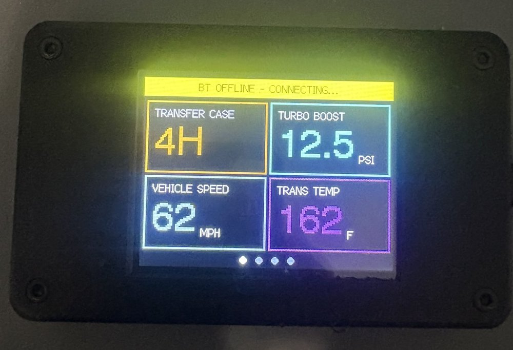
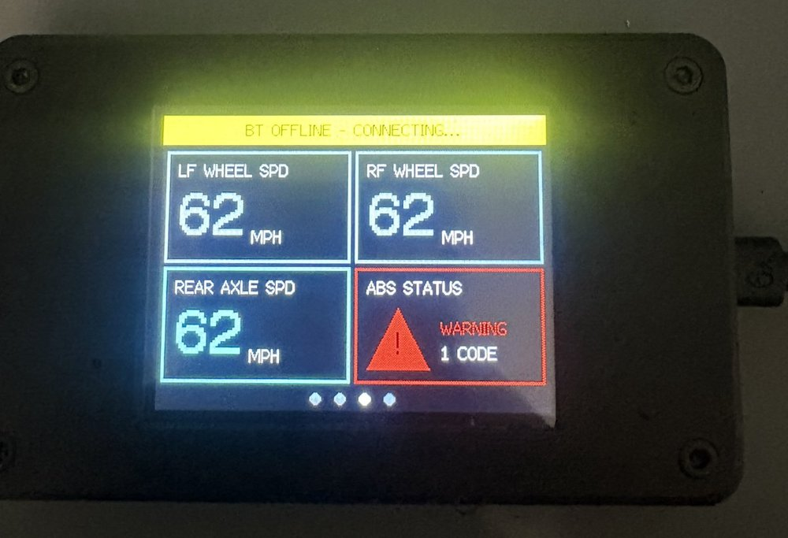
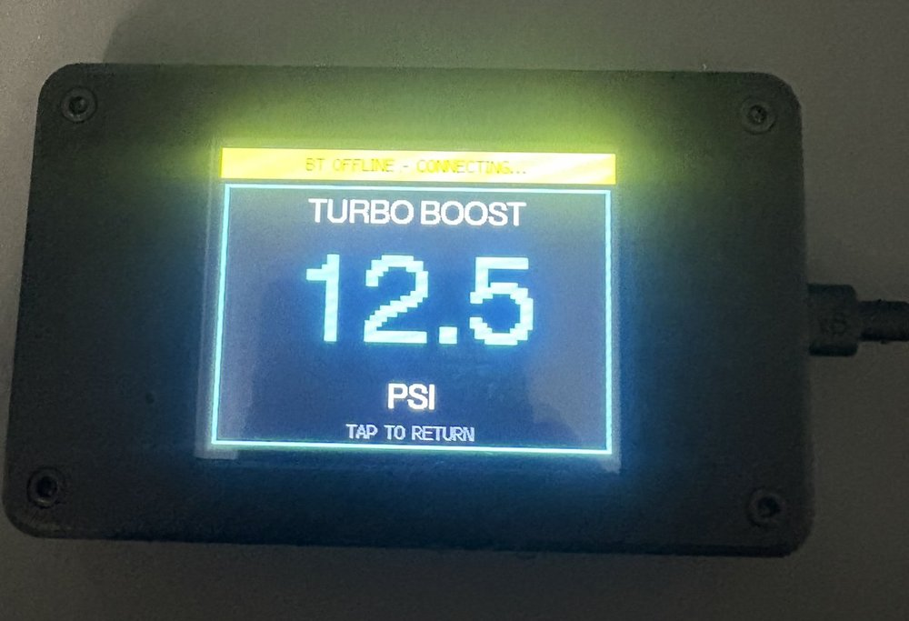
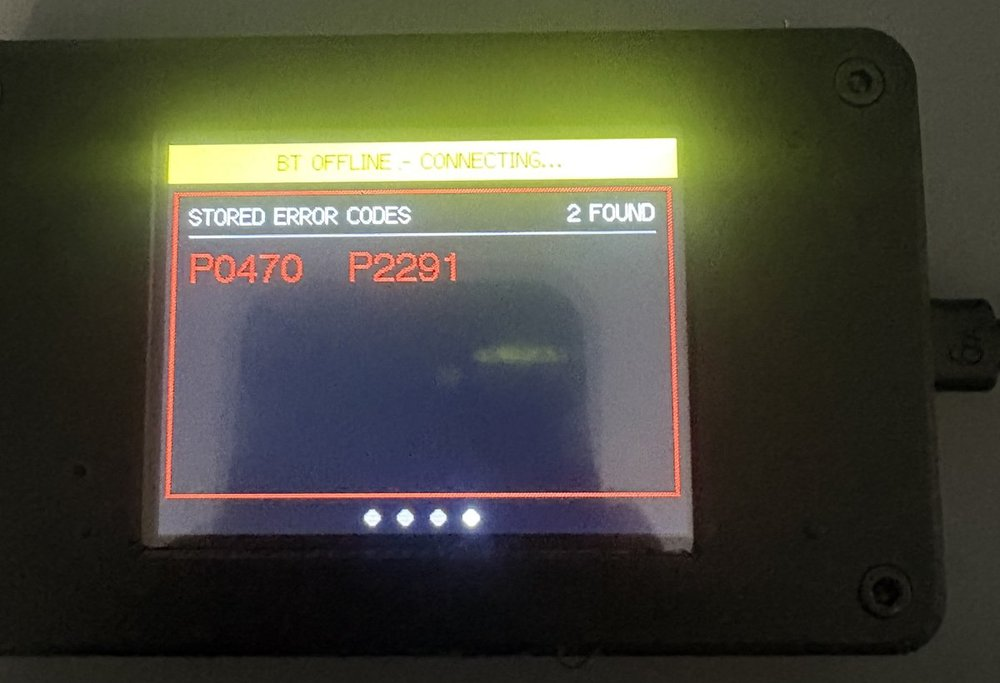

# CYD-OBDII — Diesel Diagnostics Dash

A touch-screen gauge display for a **2005 Ford Excursion 6.0L Powerstroke**, built on the
ESP32 "Cheap Yellow Display" (CYD). It talks to the truck through a Bluetooth ELM327 OBD-II
adapter and shows live engine and transmission data on pages of gauges you choose and arrange
on the display, plus stored trouble codes, a drive log to an SD card and a phone page over WiFi.

Without an adapter it runs on demo values, so you can test the screens on the bench.

**New here?** Go to [Build your own](#build-your-own). It takes about 30 minutes and needs no
wiring. The PIDs here were worked out on one truck, so on another vehicle expect to check them
([Using it on another vehicle](#using-it-on-another-vehicle)).

| Page 1: gauges | Page 3: ABS |
|---|---|
|  |  |
| **Full-screen gauge** | **Page 4: stored error codes** |
|  |  |

*The photos are from the full build in demo mode (adapter not connected), so all the values are
sample data. The gauges build recommended below has `< PREV` and `NEXT >` buttons under the
gauges, and no ABS page.*

> **Help wanted:** some values still need work, such as reading K-line modules on the display. See
> the [open issues](../../issues?q=is%3Aissue+is%3Aopen+label%3A%22help+wanted%22) if you know your
> way around 6.0L / Super Duty modules.

---

## Features

These describe the **gauges build**, the one to use. See [Which build to use](#which-build-to-use).

- **Pages**, changed with the `< PREV` and `NEXT >` buttons (dots between them show where you are)
  1. **Gauge pages**: four gauges to a page, chosen and arranged by you. There can be up to five
     pages. The defaults are boost, speed, trans temp and coolant, then FICM, volts and RPM.
  2. **Engine trouble codes** (up to 15, e.g. `P0470`): stored codes in red, then pending codes in
     yellow (detected once but not confirmed yet, so they show up before the check-engine light);
     green when clear. **Tap a code** to see what it means.
  3. **Drive log**: REC / MARK / STOP to record the gauges to the SD card, see [Drive log](#drive-log)
  4. **Settings**: brightness, units, alarm limits, power, WiFi and gauges, saved in flash, see
     [Settings page](#settings-page)
- **20 gauges to choose from**: turn each on or off in Settings, and the pages fit themselves to
  your choice, see [Choosing and arranging gauges](#choosing-and-arranging-gauges).
- **Tap menu**: tap any gauge to get **MOVE GAUGE** and **FULL SCREEN** buttons. Full screen shows
  that one gauge as large as it fits; tap again to go back.
- **Gauge alarms**: a gauge that goes out of range (low FICM voltage, hot transmission or
  coolant, low or high system voltage) flashes red, and the status bar shows it on every page,
  see [Gauge alarms](#gauge-alarms).
- **Status bar** that never scrolls: connection state, demo mode, Bluetooth retry
  countdown, gauge alarms, a red warning when engine trouble codes are stored and a yellow one
  for pending codes.
- **Phone access over WiFi**: switch on the CYD's own hotspot to see the live gauges and codes on
  your phone and update the firmware without a cable, see
  [Phone access (WiFi)](#phone-access-wifi).
- **Auto brightness**: the CYD's light sensor dims the screen at night and brings it back to full
  brightness in daylight, see [Auto brightness](#auto-brightness).
- **Battery protection**: the screen turns off when the truck is off, then the display sleeps
  and checks every few minutes whether the truck is on, see [Battery protection](#battery-protection).
- **Demo mode**: runs on sample values whenever the adapter isn't connected, and keeps retrying
  the connection in the background so the screen and touch never freeze.
- **Touch comes first**: the display keeps reading the touch screen while it waits for the truck,
  and only reads one value every 0.5 seconds, so a slow reply can't hold up a tap. Every request
  waits for the adapter's `>` prompt, so readings never get mixed up.

## Which build to use

There are two firmware builds, set up in [`platformio.ini`](platformio.ini). **Use `gauges`.**

| | `gauges` (recommended) | `esp32dev` (the full build) |
|---|---|---|
| Command | `pio run -e gauges -t upload` | `pio run -t upload` |
| Change pages | `< PREV` / `NEXT >` buttons | Tap, with a sliding animation |
| Choose, reorder gauges | Yes, 20 gauges | No, a fixed 11 gauges |
| Reads from the truck | One value every 0.5 s | Every value on the page, each refresh |
| Touch | Stays responsive | Can feel slow, because it waits for the truck |
| Drive log, phone hotspot | Yes | Yes |
| Bus sniffer page | No | Yes, but only with an adapter that supports `ATMA` |
| Transfer case and ABS pages | No, they can't answer on CAN | Yes, but they stay blank on this truck |

Plain `pio run` builds `esp32dev`, so remember the `-e gauges`. Both use the same flash layout,
so you can switch between them over USB and keep your settings.

## Hardware

| Part | Notes |
|---|---|
| ESP32-2432S028R ("Cheap Yellow Display") | 2.8" 320×240 ILI9341 screen, XPT2046 resistive touch |
| microSD card (optional) | For the drive log. FAT32; any size up to 32 GB is simplest |
| Bluetooth Classic ELM327 OBD-II adapter | Must be **Bluetooth Classic** (SPP), not BLE-only. Developed with a cheap clone that reports `ELM327v2.1`, which is fine for gauges but can't do listen-only monitoring |
| 3D-printed case | [Modular CYD case](https://www.thingiverse.com/thing:6991968) by DanielBrunod, remixed from [ncmreynolds' CYD enclosure](https://www.thingiverse.com/thing:6308391) (CC BY-SA). STL files in [`hardware/case/`](hardware/case/) |
| USB power in the truck | 5 V via the CYD's USB port |

No wiring is needed: the screen and touch are built into the CYD, and the adapter plugs
into the truck's OBD-II port under the dash.

## Build your own

You'll need the parts above and a PC with a USB data cable for the CYD.

**1. Install the tools.** Install [VS Code](https://code.visualstudio.com/) with the **PlatformIO**
extension, then clone this repo and open the folder. Libraries are installed automatically from
`platformio.ini`: `TFT_eSPI 2.5.43` and `ELMDuino 3.4.1`. Touch has its own small driver
([`src/touch_bitbang.h`](src/touch_bitbang.h)), so the SD card can use the SPI bus.

**2. Set your adapter's Bluetooth address.** This is the only code change you have to make. Pair
the adapter with a phone or PC, usually with PIN `1234`, and note its Bluetooth address. In
[`src/config.h`](src/config.h), replace the placeholder with it. For an address of
`AA:BB:CC:11:22:33`:

```cpp
const uint8_t ELM_MAC[6] = {0xAA, 0xBB, 0xCC, 0x11, 0x22, 0x33};
```

The ESP32 connects with PIN `1234`. If your adapter uses another PIN, change it in
[`src/main.cpp`](src/main.cpp). Don't publish your adapter's address if you share your fork.

**3. Build and upload.** Plug the CYD in over USB, then in a PlatformIO terminal:

```bash
pio run -e gauges -t upload
pio device monitor        # 115200 baud, optional: shows the debug log
```

The first upload has to be over USB. Later ones can go over WiFi
([Phone access](#phone-access-wifi)). If the upload can't connect, hold the board's **BOOT**
button as it starts.

**4. Try it on the bench.** With no adapter it shows demo data and `BT OFFLINE - DEMO DATA`, so you
can try every page, menu and setting. The touch calibration suits most CYDs; if taps land in the
wrong place, see [Troubleshooting](#troubleshooting).

**5. Try it in the vehicle.** Plug in the adapter, start the engine and power the CYD over USB. The
status bar shows `BT OFFLINE - CONNECTING...` until the link is up, then
`MONITOR ACTIVE`.

**6. Print the case and mount it** (optional). See [`hardware/case/`](hardware/case/). Mount the
display where it doesn't block your view, and power it from a USB supply.

## Using it on another vehicle

The firmware assumes ISO 15765-4 CAN and this truck's Ford PIDs. A different truck may need changes:

1. Run [`tools/obd_logger.py`](#pc-tools) to see the protocol, modules and supported standard PIDs.
2. Set the protocol in `tryBluetoothConnect()` in [`src/obd_engine.h`](src/obd_engine.h) if yours
   isn't `ATSP6`. Standard Mode 01 gauges often work unchanged on CAN vehicles.
3. Don't trust the Mode 22 gauges (coolant, trans temp, FICM) until you've compared them with a
   scan tool. They're specific to this truck, and two of them were wrong until they were checked.
   [Finding PIDs with FORScan](#finding-pids-with-forscan) shows how.
4. Turn off gauges your vehicle doesn't answer, in Settings. A gauge that doesn't answer just shows
   `---`, but it wastes requests.
5. To add a gauge, see [Configuration](#configuration).

## Vehicle / bus facts

Everything here was confirmed on one 2005 Excursion, using a PC, FORScan and the tools in
[`tools/`](tools/):

- Protocol: **ISO 15765-4 CAN, 11-bit, 500 kbps** (ELM protocol 6, `ATSP6`), *not* J1850 PWM
- Engine PCM: requests to **7E0**, replies from **7E8**
- Transmission module: requests to **7E1**, replies from **7E9**
- Standard PIDs the PCM answers: `0104 0105 010B 010C 010D 010F 0110 011F 0121 012C 012D 012F 0130
  0131 0133 0142 0149`
- Ford-specific FICM PID `2209D0` answers; the raw value is volts × 256
  (e.g. `0x2F80` → 47.5 V)

### The K-line: ABS and 4WD

The **ABS module** and the **GEM** talk over **ISO 9141, the K-line on OBD pin 7**, not CAN. On this
truck the GEM runs the 4WD: it had 4WD added as a conversion, so check yours. These values were
captured with FORScan on the truck. The firmware doesn't read them yet (see [Roadmap](#roadmap)).

A request is `64 <module> F5 22 hh ll <sum>`, and the reply is `<fmt> F5 <module> 62 hh ll <data>
<sum>`. `F5` is the tester, and `<sum>` is the low byte of all the bytes before it.

| Reading | Module | PID | Value |
|---|---|---|---|
| LF wheel speed (`LF_WSPD`) | ABS `28` | `223998` | One byte, mph. Scaling unproven: captured parked with the ABS light on |
| RF wheel speed (`RF_WSPD`) | ABS `28` | `223999` | Same |
| Rear axle speed (`R_DIF_SPD`) | ABS `28` | `22399C` | Same |
| 4WD switch (`4WDINP_SW`) | GEM `52` | `221921` | `02` 2H, `04` 4H, `03` 4L |
| Plates A–D | GEM `52` | `221923` | First byte, low 4 bits: A = bit 0, B = 1, C = 2, D = 3. 1 = open |
| GEM battery volts (`GEM_VBAT`) | GEM `52` | `22D102` | A / 10 V |
| Code count (`CCNT_GEM`) | GEM `52` | `220200` | A |

The plates show the transfer case's *actual* position, and the switch shows the *requested* one.
A parked truck read these, matching Ford's Pinpoint Test C32:

| Position | Switch `221921` | Plates `221923` | A | B | C | D |
|---|---|---|---|---|---|---|
| 2H | `02` | `8B` | open | open | closed | open |
| 4H | `04` | `8A` | closed | open | closed | open |
| 4L | `03` | `8C` | closed | closed | open | open |

## Where each value comes from

| Gauge | Module / header | Request | Formula | Status |
|---|---|---|---|---|
| Turbo boost | PCM `7E0` | `010B` MAP, `0133` baro | (MAP − baro) kPa × 0.145 → psi, clamped at 0 | ✅ Confirmed |
| Vehicle speed | PCM `7E0` | `010D` | A km/h × 0.621 → mph | ✅ Confirmed |
| Engine RPM | PCM `7E0` | `010C` | (A×256 + B) / 4 | ✅ Confirmed |
| System volts | PCM `7E0` | `0142` | (A×256 + B) / 1000 | ✅ Confirmed |
| FICM main power | PCM `7E0` | `2209D0` | raw / 256 V | ✅ Confirmed |
| Coolant temp | PCM `7E0` | `221139` | A × 2 °F | ✅ Confirmed against FORScan |
| Trans temp | Transmission `7E1` | `221674` | (A×256 + B) / 8 °F | ✅ Confirmed against FORScan |
| Engine trouble codes | PCM `7E0` | `03` | CAN Mode 03, multi-frame aware | ⚠️ Not yet confirmed |
| Pending trouble codes | PCM `7E0` | `07` | CAN Mode 07, same format as Mode 03 | ⚠️ Not yet confirmed |
| Transfer case | GEM `52`, **K-line** | `221921`, `221923` | see the tables above | ❌ Decoded, but not read by the firmware (the full build still tries `418F02`, which returns NO DATA) |
| Wheel speeds (LF/RF/rear) | ABS `28`, **K-line** | `223998`, `223999`, `22399C` | One byte, mph, unproven | ❌ Found, but not read by the firmware (the full build still tries placeholders at `760`) |
| ABS trouble codes | ABS `28`, **K-line** | `CCNTABS` count | | ❌ Not read by the firmware |

Turbo boost uses standard PID `0B`, which tops out at 255 kPa, so the gauge maxes out at about 22 psi of boost.

## Choosing and arranging gauges

This is in the gauges build only.

**To choose gauges:** on the Settings page, tap **MORE** until you reach **GAUGES A** to **E**, and
turn each gauge ON or OFF. The gauges that are on fill the pages in order, four to a page, and the
pages grow or shrink to fit. The last gauge can't be turned off.

**To rearrange them:** tap a gauge and choose **MOVE GAUGE**. `< EARLIER` and `LATER >` then shift
it one place at a time, across pages if needed, and **DONE** ends. Both are saved on each display,
and **DEFAULTS** on the Settings page puts them back.

A hidden gauge with an alarm limit is still checked in the background. The original seven gauges
are on by default. A 4-gauge page updates about every 2 seconds, and a full-screen gauge about
every 0.5 seconds. Temperatures update every 2 seconds at most.

The optional gauges are standard Mode 01 PIDs that the PCM answered in the October log, using the
standard formulas. They haven't been compared with FORScan yet, so check any you plan to rely on.
Pedal position and EGR error are the least proven:

| Gauge | Request | Formula |
|---|---|---|
| Engine load | `0104` | A × 100 / 255 % |
| Intake air temp | `010F` | A − 40 °C → °F |
| Mass air flow | `0110` | (A×256 + B) / 100 g/s |
| Engine run time | `011F` | A×256 + B seconds, shown as min:sec |
| Fuel level | `012F` | A × 100 / 255 % |
| Manifold pressure | `010B` | A kPa |
| Baro pressure | `0133` | A kPa |
| EGR command | `012C` | A × 100 / 255 % |
| EGR error | `012D` | (A − 128) × 100 / 128 % |
| Pedal position | `0149` | A × 100 / 255 % |
| Distance with MIL on | `0121` | A×256 + B km → mi |
| Distance since codes cleared | `0131` | A×256 + B km → mi |
| Warm-ups since codes cleared | `0130` | A |

## Trouble code descriptions

On the codes page, **tap a code** to open a box with what it means, e.g. `P0470` → "Exhaust back
pressure (EBP) sensor circuit". Pending codes also explain that they've been seen once but aren't
confirmed yet. Tap anywhere to close the box.

The list in [`src/dtc_descriptions.h`](src/dtc_descriptions.h) covers the codes common on the
6.0L Powerstroke (EBP, ICP, FICM, EGR, glow plugs, turbo, injectors by cylinder) plus generic
OBD-II codes and the Ford ABS wheel-speed codes. A code that isn't listed says whether it's a
generic or a Ford-specific code. To add one, add a row: `{"P0123", "What it means"},`.

## Drive log

The LOG page (after the codes page) records the gauges to the SD card for charting later, e.g.
trans temp and boost over a long tow:

1. Put a FAT32 microSD card in the CYD (it can go in while it's running).
2. On the LOG page tap **REC**. It shows the file name (`DRIVE001.CSV`, `DRIVE002.CSV`, ...), the
   recording time, rows and size.
3. Tap **MARK** to note a moment (start of a hill, a warning light); it goes into that row.
4. Tap **STOP**. Leaving the page doesn't stop it; the display going to sleep does.
5. Get the file from the card on a PC, or from the phone's **Logs** tab
   ([Phone access](#phone-access-wifi)), and open it in Excel or Google Sheets.

The file has one row per second:

```
seconds,TURBO BOOST (PSI),VEHICLE SPEED (MPH),TRANS TEMP (F),FICM MAIN PWR (V),COOLANT TEMP (F),SYSTEM VOLTS (V),ENGINE RPM,alarms,mark,codes
12.0,14.2,58,186,48.1,197,14.1,2150,,,P0470 P2291 pending:P0128
13.0,14.6,59,187,48.0,197,14.1,2180,,MARK 1,
```

- Values are always in °F and MPH, whatever the screen shows, so a file never mixes units.
- `alarms` lists the gauges in alarm; `codes` is filled on the first row and whenever the stored
  or pending codes change.
- In the gauges build, the file has a column for each gauge that was on when you tapped REC.
  Those columns stay fixed for that file, even if you change gauges while recording.
- While recording, gauges that aren't on screen are still read, one every 0.5 seconds in the
  gauges build so touch stays responsive. With many gauges on, a value in a row can be several
  seconds old, so show fewer gauges to catch fast changes like a boost spike.
- The transfer case and wheel speeds aren't logged: the firmware can't read them yet.
- Rows are only written while the truck answers, never demo values.
- The file is saved to the card every 5 seconds, so unplugging loses at most the last 5 seconds.
  `DRIVE_LOG_INTERVAL_MS` and `DRIVE_LOG_FLUSH_MS` in `config.h` change the timings.

## Finding PIDs with FORScan

This is how the coolant, trans temp, ABS and GEM values above were found. FORScan knows each
reading's request and conversion (it shows names like `ECT` or `LF_WSPD` with real values), but
doesn't show the raw request it sends. So with a **Y-cable** on the OBD port, FORScan on one
adapter does the asking, and a second adapter just listens.

```
              ┌─ adapter 1 ── laptop running FORScan            (asks for the data)
OBD port ── Y ┤
              └─ adapter 2 ── laptop, tools/sniff_logger.py     (only listens, records)
```

**The listening adapter matters.** It must accept `ATMA` (monitor mode) and `ATCSM1` (silent
monitoring, so it can't disturb the bus). Many cheap clones don't. The tested setup was:

| Job | Adapter | Result |
|---|---|---|
| Listener | OBDLink EX (USB) | Accepts both; `sniff_logger.py` refuses to run if an adapter doesn't |
| FORScan | USB `ELM327 v1.5` clone with an HS/MS switch, set to **HS** | Reads the PCM, transmission, ABS and GEM. FORScan warns about it, so use it for reading only |
| Not usable as a listener | Bluetooth `ELM327v2.1` clone | Answered `?` to `ATMA` every time |

**Recording**

1. With both adapters on the Y-cable and the key on, connect FORScan.
2. In FORScan, open **Live Data** and select a reading. Note the value it shows.
3. Record with [`tools/sniff_logger.py`](tools/README.md#sniff_loggerpy), in the matching mode:

   | Mode | Listens to | Use it for |
   |---|---|---|
   | `engine` | CAN IDs 7E0–7EF | PCM and transmission readings |
   | `diag` | CAN IDs 700–7FF | Finding other modules on CAN |
   | `all` | Every CAN ID | Seeing what's on the bus (overflows in under 2 seconds on this truck) |
   | `kline` | ISO 9141, OBD pin 7 | The ABS and GEM |

4. Match the reply with FORScan's value. On this truck, for example:

   ```
   7E0 03 22 11 39 00 00 00 00     <- request: service 22, PID 1139
   7E8 04 62 11 39 5E 00 00 00     <- reply: 5E = 94, and FORScan showed 188 °F, so A × 2 = °F
   ```

**Tips**

- Record at least two different values (cold and warm, 2H / 4H / 4L) before trusting a formula.
  Read the value at the moment you capture, or do it when the reading has stopped moving.
- One reading at a time keeps a capture easy to match. Selecting them all at once in FORScan shows
  every PID a module uses, and many readings can share a PID as bits, so change one input at a
  time and see which bit moves.
- K-line lines may be tagged `<DATA ERROR` and split after 12 bytes. Check the sum byte before
  discarding them: on this truck they were all valid.
- FORScan can't read two modules at the same time, so coolant and trans temp need separate captures.
- In FORScan, use **Live Data only**. Service Functions and Configuration send commands to the
  modules.

The full build also has a **SNIFF page** that records to the CYD's SD card (`SNIFnnn.TXT`). It needs
a Bluetooth adapter that supports `ATMA`. With one that doesn't, it records nothing and doesn't say
why, so check that the file has more than `?` lines.

## Settings page

The settings page (the last page) changes these without editing code. Changes are saved
in the ESP32's flash 2 seconds after the last tap, so they survive power-off and firmware uploads.

| Section | Setting | Default |
|---|---|---|
| DISPLAY | Auto brightness on/off, night brightness (5–100%), temperature °F/°C, speed MPH/KM/H | on, 10%, °F, MPH |
| ALARMS | Gauge alarms on/off, FICM low, trans temp high, coolant high | on, 45.0 V, 220 °F, 230 °F |
| VOLTAGE | System volts low / high alarm | 11.8 V / 15.0 V |
| POWER | Screen off after (never, 1–30 min), sleep after (never, 5–60 min) | 2 min, 5 min |
| WIFI | Phone hotspot on/off, plus the network name, password and address | off |
| UPDATE | Allow firmware upload from the phone | off |
| GAUGES A–E | Each gauge on/off (gauges build) | The original seven on |

- Each row has one button (tap to switch) or **−** / **+** buttons.
- **MORE** goes to the next section, **NEXT >** to the next page.
- **DEFAULTS** puts everything back to the defaults: tap it, it turns red (`SURE?`), then tap
  again within 3 seconds.
- The defaults are the values in [`src/config.h`](src/config.h). Temperatures are kept in °F
  and speeds in MPH internally; the units settings only change what's shown, so alarm limits
  stay the same whichever units you pick.

## Phone access (WiFi)

The CYD can run its own WiFi hotspot, so a phone can see the dash without any app:

1. On the CYD: Settings → **MORE** to **WIFI** → **Phone hotspot ON**.
2. On the phone, join the WiFi network **`CYD-OBDII`**. The password is shown on the same
   Settings page: each display makes its own random password the first time the hotspot
   starts, and keeps it. If the phone warns that the network has no internet, choose to stay
   connected.
3. Open **http://192.168.4.1** in the phone's browser.

| Tab | What it does |
|---|---|
| **Live** | The chosen gauges in the screen's order (all gauges in the full build), in the units chosen on the CYD; alarms in red; stored and pending codes with their descriptions. Only the page on the CYD's screen is read, so other gauges can be out of date |
| **Logs** | The drive logs on the SD card (`DRIVEnnn.CSV`): download to the phone or delete. The file being recorded is shown but can't be downloaded until you STOP |
| **Update** | Upload a new firmware `.bin` (from `.pio/build/gauges/firmware.bin` after a PlatformIO build). First allow it on the CYD: Settings → **UPDATE** → **Allow upload ON** (turns itself off after 5 minutes). The CYD restarts with the new firmware when the upload is checked |

- The phone only sees what the display already reads: no extra requests go to the truck.
- The hotspot is **off by default** because it draws about 100 mA; the setting is remembered.
  While a phone is using the page the display stays awake.
- Anyone in range who knows the password can see the gauges and download or delete drive logs.
  To make a new password, tap **Password** on the WIFI settings page; phones then have to join
  again with the new one.
- Replacing the firmware also needs someone at the display to switch **Allow upload** on, so the
  password alone isn't enough to install other firmware.
- The first install has to be over USB, to set the flash layout. After that, updates can go over
  WiFi.

## Gauge alarms

A gauge whose value goes outside its limits gets a red frame and flashes solid red, and the
status bar turns red with the reading, e.g. `[!] TRANS TEMP HIGH: 224 F`, on whatever page is
showing. Gauges with limits are also read in the background while they're on another page or
turned off: every 5 seconds in the gauges build, every 2 seconds in the full build. So an alarm
on a gauge you aren't looking at can take several seconds to appear. Each alarm and its clearing are logged to serial
(`ALARM` lines). Alarms only use live readings, never demo data.

| Gauge | Alarm when (default) | Default in [`src/config.h`](src/config.h) |
|---|---|---|
| FICM main power | below 45.0 V | `ALARM_FICM_LOW_V` |
| Trans temp | above 220 °F | `ALARM_TFT_HIGH_F` |
| Coolant temp | above 230 °F | `ALARM_ECT_HIGH_F` |
| System volts | below 11.8 V or above 15.0 V | `ALARM_VOLTS_LOW_V`, `ALARM_VOLTS_HIGH_V` |

Change the limits, or switch alarms off, on the [Settings page](#settings-page) (ALARMS and
VOLTAGE); `config.h` only holds the defaults. To add a limit to another gauge, or remove one, edit
the last two columns (low limit, high limit) of its row in the `metrics[]` table in
[`src/display_ui.h`](src/display_ui.h); they point at a limit value, and `NO_ALARM` means no limit.
For example, to warn above 3,200 RPM:

```cpp
static const float RPM_HIGH = 3200;   // above the metrics[] table
{"ENGINE RPM",     &valRPM,    "",    TFT_WHITE,   pollRPM,    NO_ALARM, &RPM_HIGH},
```

`ALARM_CHECK_INTERVAL_MS` (5000 in the gauges build, 2000 in the full build) sets how often
off-screen gauges are checked, and `ALARM_BLINK_MS` (500) the flash speed.

## Auto brightness

The light sensor on the front of the CYD (an LDR on GPIO34) sets the backlight brightness.

- On this board the sensor reads **0 in normal room light or brighter**, rises to 100–350 in
  shade and to about 2,600 in full darkness (higher = darker).
- 0 gives 100% brightness; a reading of 2,000 or more gives the 10% night floor. The curve is
  squared, so dusk and shade only dim the screen a little and it drops off near full darkness.
- The reading is smoothed over about 3 seconds, so a passing shadow or headlights don't make the
  screen flicker.

### Changing the brightness levels

**Auto brightness on/off** and the **night brightness** are on the [Settings page](#settings-page)
(DISPLAY). The rest are in the "Auto brightness" block of [`src/config.h`](src/config.h); after
changing one, upload again (`pio run -e gauges -t upload`).

| Setting | Default | What it does |
|---|---|---|
| `AUTO_BRIGHTNESS` | `true` | Default for the Settings page switch (`false` = always 100%) |
| `BRIGHTNESS_MIN_PCT` | `10` | Default night brightness, in % |
| `LDR_DARK_RAW` | `2000` | Sensor reading at which the screen reaches the night brightness |
| `LDR_BRIGHT_RAW` | `0` | Sensor reading at which the screen is at 100% |
| `LIGHT_SMOOTHING_MS` | `3000` | How quickly the brightness follows the light, in ms (higher = slower and steadier) |
| `LIGHT_LOG_INTERVAL_MS` | `0` | How often to log sensor readings, in ms (`0` = off; use `500` for calibration) |

Common adjustments:

- **Too dim at night / too bright at night:** Settings page → DISPLAY → Night brightness.
- **Dims too early (at dusk or in shade):** raise `LDR_DARK_RAW`, e.g. `2400`; the screen then
  only dims in deeper darkness.
- **Doesn't dim enough at night:** lower `LDR_DARK_RAW`, e.g. `1000`, so a less dark cab already
  counts as full darkness.
- **Brightness hunts or flickers** (streetlights, shadows): raise `LIGHT_SMOOTHING_MS`, e.g.
  `6000`. **Reacts too slowly** (tunnels): lower it, e.g. `1500`.

### Recalibrating for your board

The sensor's range differs between CYD boards, so if the defaults don't suit yours:

1. In [`src/config.h`](src/config.h), set `LIGHT_LOG_INTERVAL_MS = 500` and upload.
2. Open the serial monitor (`pio device monitor`). Twice a second it logs a line like
   `(LIGHT): LDR raw 2587, smoothed 2555 -> backlight 10%`. `raw` is the sensor reading.
3. Note the `raw` value in each lighting condition you care about: daylight, the cab at dusk,
   the cab at night with the dash lights on, and fully covered.
4. Set `LDR_BRIGHT_RAW` to the reading where you still want 100% (usually `0`) and
   `LDR_DARK_RAW` to the reading where you want the night level.
5. Set `LIGHT_LOG_INTERVAL_MS` back to `0` and upload again.

On the board this was developed on, the readings were 0 in room light, 100–350 in shade and
about 2,600 fully dark. Higher always means darker on the CYD.

## Battery protection

The OBD port's power pin is live with the key off, so the display powers itself down when the
truck goes quiet:

1. After **2 minutes** with no activity the backlight turns off. A tap turns it back on (that
   tap doesn't press anything on screen).
2. After **5 minutes** the ESP32 goes into **deep sleep** with the screen off.
3. It wakes on a **tap**, and also every **5 minutes** for a timed check: it starts with the
   screen still off and tries the adapter for 30 seconds. If the PCM answers (key on) the screen
   comes on; if not, it goes back to sleep. So after you start the truck the screen comes on by
   itself within about 5 minutes, or straight away if you tap it.

"Activity" means **the PCM answering a request**, or a tap. The Bluetooth link alone doesn't
count, because the adapter is powered from the OBD port and stays connected with the key off.
On the bench with no adapter, the display sleeps after 5 minutes too; tap to wake it. The screen-off
and sleep times can be changed on the [Settings page](#settings-page) (POWER).

| Setting | Default | What it does |
|---|---|---|
| `SCREEN_OFF_AFTER_MS` | 120000 | Backlight off after this long with no activity (0 = never) |
| `SLEEP_AFTER_MS` | 300000 | Deep sleep after this long with no activity (0 = never) |
| `WAKE_CHECK_INTERVAL_MS` | 300000 | How often a sleeping display wakes to check the truck (0 = only wake on a tap) |
| `WAKE_CHECK_MS` | 30000 | How long each check tries the adapter before sleeping again |

The ELM327 adapter itself keeps drawing current from the OBD port the whole time (typically
tens of mA), whatever the display does. Unplug it, or use one with an auto-sleep mode, if the
truck sits for long periods. The CYD board also draws a few mA in deep sleep (regulator,
USB-serial chip, power LED), plus about 30 s awake every 5 minutes for the checks.

## Configuration

Brightness, units, alarm limits, the power timers and WiFi are on the
[Settings page](#settings-page). Everything else is in [`src/config.h`](src/config.h) (the
values marked "default" are what the Settings page starts with and goes back to):

| Setting | Default | What it does |
|---|---|---|
| `ELM_MAC` | placeholder | Bluetooth address of your ELM327 |
| `POLL_INTERVAL_MS` | 500 (full build: 250) | How often one value (full build: the whole page) is read |
| `TEMP_POLL_INTERVAL_MS` | 2000 | The fastest coolant and trans temp are read |
| `DTC_SCAN_INTERVAL_MS` | 60000 (full build: 10000) | How often engine codes are re-checked |
| `BT_RETRY_INTERVAL_MS` | 10000 | Wait between Bluetooth connection attempts |
| `MENU_TIMEOUT_MS` | 4000 | How long the tap menu stays up |
| `ALARM_*` | see [Gauge alarms](#gauge-alarms) | Default alarm limits for FICM, trans temp, coolant and system volts |
| `AUTO_BRIGHTNESS` | true | Default: set the backlight from the light sensor |
| `BRIGHTNESS_MIN_PCT` | 10 | Default night-time backlight level |
| `LDR_DARK_RAW` / `LDR_BRIGHT_RAW` | 2000 / 0 | Sensor readings for the night floor / full brightness |
| `SCREEN_OFF_AFTER_MS` / `SLEEP_AFTER_MS` | 120000 / 300000 | Defaults: screen off / deep sleep after this long with no activity |
| `WIFI_AP_SSID` | CYD-OBDII | The phone hotspot's network name (the password is random per display, see [Phone access](#phone-access-wifi)) |
| `FW_UPLOAD_UNLOCK_MS` | 300000 | How long **Allow upload** stays on for firmware updates from the phone |
| `WAKE_CHECK_INTERVAL_MS` / `WAKE_CHECK_MS` | 300000 / 30000 | Timed wake-up checks while asleep |
| `TOUCH_RAW_*` | 200–3700 / 240–3800 | Touch calibration (the defaults work on the tested board) |

**Adding a gauge (gauges build):** you don't need to edit anything to move one; use the display.
To add a new one:

1. Write a poll function in [`src/obd_engine.h`](src/obd_engine.h). `readMode01()` handles
   standard PIDs: `pollLoad()` is a one-line example.
2. Add its value in [`src/config.h`](src/config.h) and [`src/globals.cpp`](src/globals.cpp).
3. Add a row at the **end** of the `GAUGES_ONLY` part of `metrics[]` in
   [`src/display_ui.h`](src/display_ui.h). Saved choices are stored by position, so keep existing
   rows where they are.
4. Add a `GAUGE_ROW(n)` for it in the same file, and update the count in the `static_assert`
   beside them. The Settings sections hold four rows each, so 21 gauges needs a new section.

In the full build, pages are filled 4 at a time in `metrics[]` order, so editing that table is
all you need.

## Project structure

```
CYD-OBDII/
├── platformio.ini       Board, display pin setup (TFT_eSPI build flags), libraries
├── src/
│   ├── config.h         Pins, tuning constants, adapter MAC, shared declarations
│   ├── globals.cpp      Shared objects and values, demo values
│   ├── main.cpp         setup() / loop(): touch, refresh timing, connect/disconnect handling
│   ├── obd_engine.h     ELM327 communication, PID decoding, DTC reading, Bluetooth task
│   ├── display_ui.h     Gauge table, alarms, cards, full-screen gauge, tap menu, status bar, pages
│   ├── brightness.h     Auto brightness: light sensor -> backlight PWM
│   ├── settings.h       Settings page values, saved in flash (NVS)
│   ├── drive_log.h      Drive log: gauges to DRIVEnnn.CSV on the SD card
│   ├── bus_sniffer.h    Bus sniffer: raw bus traffic to SNIFnnn.TXT on the SD card
│   ├── sd_card.h        SD card setup, shared by the loggers
│   ├── touch_bitbang.h  XPT2046 touch driver (bit-banged, frees the SPI bus for the SD card)
│   ├── dtc_descriptions.h  What each trouble code means
│   ├── wifi_portal.h    Phone hotspot: live page, firmware update
│   └── power.h          Battery protection: screen off, deep sleep, wake on a tap or timed check
├── hardware/
│   └── case/            3D-printable case (STL files, credits, build notes)
├── tools/
│   ├── obd_logger.py    PC script that surveys the truck through a USB ELM327 and writes a log
│   └── sniff_logger.py  PC script that records what FORScan asks and the modules answer
├── docs/                Reference captures from the truck
└── test/
    └── serialLog.txt    Serial log captured in the truck (used to fix reply timing and FICM scaling)
```

## PC tools

Both run on a PC with a USB adapter (`pip install pyserial`). See
[`tools/README.md`](tools/README.md) for the options.

- [`tools/obd_logger.py`](tools/README.md#obd_loggerpy) surveys a vehicle: the protocol, every
  module that answers, each module's supported PIDs and their decoded values, all in one text file.
  It only sends read requests. Add `--kline` to probe the K-line.
- [`tools/sniff_logger.py`](tools/README.md#sniff_loggerpy) records what FORScan asks and the
  modules answer, see [Finding PIDs with FORScan](#finding-pids-with-forscan). It only listens.

```bash
python tools/obd_logger.py --note "engine idling, warm"
python tools/sniff_logger.py --port COM3 --mode engine
```

## How it works

- **Two cores:** Bluetooth connection attempts run in a background FreeRTOS task on
  core 0. Drawing, touch and polling run in `loop()` on core 1, so a slow connect never
  freezes the screen.
- **Touch during requests (gauges build):** while waiting for the adapter's reply, `elmCommand()`
  calls `elmWaitHook`, which keeps reading the touch screen. That and slower polling are what make
  the display responsive.
- **Request/reply sync:** each command is sent and the reply is read up to the ELM `>`
  prompt before the next one goes out. `ATSH` (set header) is only sent when the target
  module changes. Fixed delays turned out to make replies arrive one request late over
  Bluetooth.
- **Drawing:** the 320×214 gauge area is drawn off-screen in four quarter-height 8-bit strips
  (about 17 KB) and each strip is pushed in one go, so updates don't flicker. In the full build,
  page changes slide horizontally. (`CANVAS_STRIPS` in `config.h`; one full-size strip is faster
  but needs about 68 KB.)
- **Memory for Bluetooth + WiFi:** Bluetooth Classic takes about 88 KB of RAM and the hotspot
  about 50 KB, which doesn't fit next to a full-size drawing buffer with the SD card as well. So
  the buffer is split (above), and Bluetooth is started Classic-only, which hands the unused BLE
  memory back. The gauges build has about 102 KB free after Bluetooth starts. If the hotspot can't
  start, the Settings page shows `FAILED`.
- **Flash layout:** Bluetooth + WiFi make the firmware about 1.7 MB, more than the default
  1.25 MB slot, so `platformio.ini` uses the `min_spiffs` layout (two 1.9 MB slots, so WiFi
  firmware updates still work). The saved settings are kept when switching layouts.
- **Debug log:** everything is logged over USB serial at 115200 with timestamps, e.g.
  `010C -> 410C0AD6` or `Page 0 refreshed in 380 ms`.

## Troubleshooting

| Symptom | Likely cause |
|---|---|
| Stuck on `BT OFFLINE - CONNECTING...` | Wrong `ELM_MAC`, adapter not powered, adapter connected to a phone instead, or a BLE-only adapter |
| Upload can't connect | Use a USB data cable, close any serial monitor, and hold **BOOT** as the upload starts |
| Display feels slow | You may be on the full build: use `-e gauges`. Turning the hotspot off also frees memory |
| Settings differ between two displays | Settings, gauge choices and the hotspot password are saved on each display |
| `BT STACK FAILED - DEMO DATA` | ESP32 Bluetooth failed to start; power-cycle the CYD |
| A gauge stays at `---` | The truck doesn't answer that PID; check the serial log for `no valid reply` |
| Taps hit the wrong gauge | Recalibrate `TOUCH_RAW_*` using the `Tap -> RawX/RawY` lines in the serial log |
| Readings look swapped between gauges | Replies are out of sync; check for `Timeout waiting for '>'` in the log |

## Roadmap

- [x] Remove screen swiping from the gauges build and change pages with touch buttons instead
- [x] Choose and rearrange gauges on the display
- [ ] Test gauge selection, move mode, the hotspot and the drive log in the gauges build on a truck
- [ ] Compare the 13 optional gauges with FORScan
- [ ] Find out whether the Bluetooth `ELM327v2.1` adapter can reach the K-line at all
- [ ] Make the SNIFF page report an adapter that rejects `ATMA` instead of retrying silently
- [x] Confirm the ABS and 4WD modules are on the K-line (pin 7): ABS is module `28` and the GEM,
      which runs 4WD on this truck, is module `52`
- [x] Find the numeric PIDs for the 4WD switch, `PLATE_A`–`D`, `LF_WSPD`, `RF_WSPD` and `R_DIF_SPD`
- [ ] Prove the wheel speed scaling with a rolling reading, after the ABS repair
- [ ] Read the ABS and 4WD modules through the ELM327 on the K-line. Most ELM327 adapters also
      speak ISO 9141 (protocol 3), so this may need no new hardware, but the adapter has to switch
      protocols (and re-init the K-line, about 2–3 s) between the PCM on CAN and these modules
- [ ] Test the WiFi firmware update
- [x] Confirm coolant temp and trans temp against FORScan
- [ ] Confirm DTC reads in a new truck log
- [ ] Hard-wire the CYD to the CAN bus instead of using the Bluetooth ELM327 adapter: in progress
      in [CYD-OBDII-CAN](https://github.com/cbrochar/CYD-OBDII-CAN) (TWAI + SN65HVD230), which also
      has a CAN sniffer with SD card recording
- [ ] Measure the key-off current draw (screen-off, deep sleep and timed wake-up checks are done
      and tested on the bench; the ELM327 adapter draws current on its own as well)

## Contributing

Ideas, bug reports and pull requests are welcome.

- **Know a Ford PID or module address?** The open [`help wanted`](../../issues?q=is%3Aissue+is%3Aopen+label%3A%22help+wanted%22)
  issues list what's still unknown. Log output from [`tools/obd_logger.py`](tools/) or FORScan is the most useful thing you can add.
- **Code feedback:** open an issue or start a thread in Discussions. The ELM327 reply handling in
  [`src/obd_engine.h`](src/obd_engine.h) and the drawing code in
  [`src/display_ui.h`](src/display_ui.h) are good places to start.
- Please only add **read-only** requests (see Safety below).

## Safety

This project only **reads** data (services `01`, `03`, `07`, `22`, `18`). Don't add requests that
command modules (services `2E`, `2F`, `31`, `10`), since those can actuate hardware or change
settings. Mount the display where it doesn't block your view, and don't operate it while
driving.

## License

The code is released under the [MIT License](LICENSE). The 3D-printable case in
[`hardware/case/`](hardware/case/) is a remix of designs by DanielBrunod and ncmreynolds and stays
under **CC BY-SA**. See [hardware/case/README.md](hardware/case/README.md).
